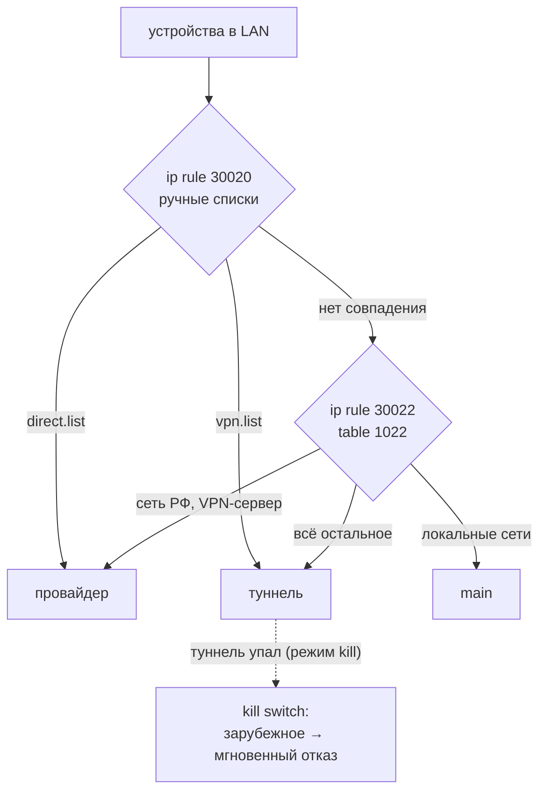
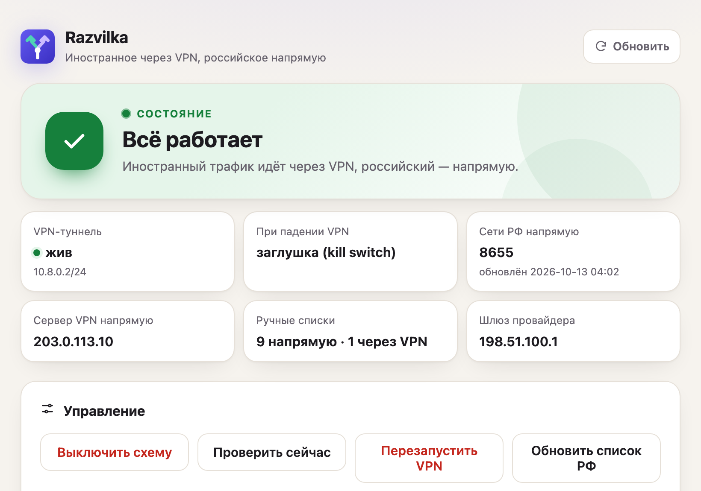
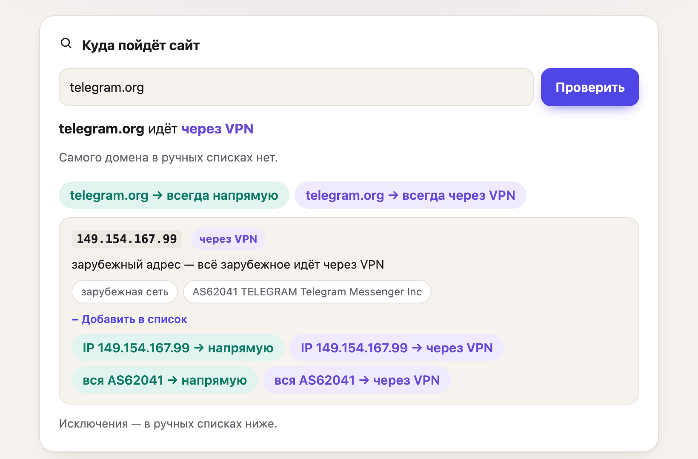

<p align="center">
  
</p>

<p align="center"><b>Развилка для трафика на роутерах Keenetic и Netcraze:</b> российское — напрямую, иностранное — через VPN.</p>


**Razvilka** — пакет для роутеров **Keenetic и Netcraze** с Entware: весь **иностранный трафик через VPN, российский — напрямую**,
kill switch и веб-морда управления. Ставится одной командой.

Зачем: когда провайдер душит или режет зарубежные сайты, а VPN нужен «для всего иностранного», но
российские сервисы (онлайн-кинотеатры, банки, Госуслуги) должны видеть российский IP.

| | куда | почему |
|---|---|---|
| Кинопоиск, KION, Okko, Иви, банки, Госуслуги | напрямую | сети РФ + ручной список |
| Telegram, YouTube, ChatGPT, зарубежные сайты | через VPN | не-российские адреса |
| что угодно | как скажете | ручные списки: домен, IP, подсеть, AS |

> Razvilka — **не VPN**: туннель не поднимает и не содержит. Это правила маршрутизации поверх подключения,
> которое у вас уже настроено на роутере.

## Как это работает

Порядок правил маршрутизации (первое совпадение выигрывает):

1. **Ручные списки** — `direct.list` (всегда напрямую) и `vpn.list` (всегда через VPN): домены, IP, подсети
   и автономные системы (`AS13238`).
2. **Сети РФ напрямую** — ~8 600 подсетей (ipdeny / ipverse, обновляются раз в сутки).
3. **Всё остальное — через VPN.**

Плюс служебные исключения: адрес VPN-сервера и локальные сети всегда идут как есть.

Это логика **наоборот** по сравнению со списками блокировок (antifilter и т.п.):

| | списки блокировок | Razvilka |
|---|---|---|
| новый заблокированный ресурс | ждать, пока попадёт в список | уже в VPN |
| зарубежный сайт, который провайдер замедляет | напрямую, тормозит | в VPN |
| российский сервис на адресе из списка (CDN, DDoS-защита) | в VPN — видит иностранный IP | напрямую |



**Сторож** раз в минуту проверяет туннель. Если VPN не отвечает 2 минуты подряд:
- `direct` (по умолчанию) — зарубежное временно идёт напрямую через провайдера. Работает всё, просто без туннеля;
- `soft` — мягкий kill: зарубежное закрыто, кроме разрешённого — CDN, шрифтов и библиотек, на которых
  держатся российские сайты. Наборы включаются галочками в веб-панели, свои записи — в `lists/kill-allow.list`;
- `kill` — строгий kill: закрыто всё зарубежное, ничего не идёт мимо туннеля. Российские сайты, частично
  работающие с зарубежных CDN, в это время могут открываться не полностью.

| Набор для `soft` | Что внутри | По умолчанию |
|---|---|---|
| Cloudflare | AS13335 | ✓ |
| Akamai | AS20940, AS16625 | ✓ |
| Fastly | AS54113 | ✓ |
| CDN библиотек | cdnjs, jsDelivr, unpkg | ✓ |
| Шрифты и библиотеки Google | fonts.googleapis.com, fonts.gstatic.com, ajax.googleapis.com | ✓ |
| Капча | reCAPTCHA, hCaptcha | ✓ |
| Аналитика Google | google-analytics, googletagmanager | |

Разрешённое резолвится заранее, пока туннель работает (AS — через RIPEstat, домены — раз в час). У Google общие
входные серверы на все сервисы, поэтому разрешённые шрифты частично открывают напрямую и другие сервисы Google.

Когда VPN оживает — всё возвращается само.


### Под капотом

- **Только ядро.** `ip rule` и две таблицы маршрутизации: `1020` — ручные списки, `1022` — сети РФ,
  исключения и `default dev <туннель>`. Без прокси в userspace, без перехвата DNS и TPROXY — скорость
  равна скорости туннеля, CPU роутера не нагружается. Около 1 400 строк POSIX sh, без Python/PHP/Node.
- **Адрес VPN-сервера** всегда идёт мимо туннеля, иначе петля. Определяется сам: по соединениям процесса
  VPN-клиента (`netstat -p`) или по `endpoint` у awg/wg; последний известный запоминается — когда туннель
  лежит, соединения нет, а исключение нужно.
- **Kill switch** — тоже маршрутами: `default` в table 1022 и записи `vpn.list` → `prohibit` (мгновенный
  отказ, без таймаутов). Трафик самого роутера идёт через провайдера (`ip rule iif lo lookup main`), чтобы
  работали DNS и переподключение туннеля. При переключениях сбрасываются соединения домашней сети
  (`conntrack`), иначе аппаратное ускорение Keenetic держит их на старом маршруте.
- **Домашняя сеть** всегда маршрутизируется по `main` (`ip rule to <частные сети>`), независимо от состояния
  таблиц Razvilka.
- **Сторож** чинит то, что ломается само: туннель пересоздал интерфейс — маршруты через него исчезли;
  сменился шлюз провайдера или адрес VPN-сервера — таблицы перестраиваются. После каждой перестройки
  сбрасывается кэш маршрутов ядра — в Keenetic он есть и иначе держит старые решения.
- **AS** раскрываются через RIPEstat (`announced-prefixes`), домены — через `dig` раз в час; для веб-панели
  скрипт хранит, из какой записи списка взялся каждый адрес.

**Страница статуса** `http://razvilka.lan` (или `http://<роутер>:98/status`) — без пароля, только чтение: работает ли VPN и с какого
времени, что сейчас происходит с зарубежным трафиком, последние события. Обновляется сама — её можно дать
домашним.

**Веб-морда** (`http://razvilka.lan/admin` или `http://<роутер>:98`, логин `admin`): статус, вкл/выкл, режим при падении VPN, тест kill switch,
«куда пойдёт сайт», редактор ручных списков, журнал.

«Куда пойдёт сайт» показывает итог для домена (через VPN / напрямую / по-разному), записан ли сам домен
в списках, и по каждому его адресу: куда идёт и почему, в каких списках есть и по какой записи (домен,
подсеть или AS), сеть РФ или зарубежная, чья автономная система (RIPEstat). Под результатом — кнопки
«добавить в список»: домен, каждый IP или всю его AS — в «напрямую» или «через VPN», применяется сразу.

<p align="center">
  
  
</p>

## Что нужно заранее

- Роутер **Keenetic или Netcraze** (Netcraze — российский бренд Keenetic, та же KeeneticOS) с **Entware**
  и SSH к нему (обычно dropbear на порту 222).
- **Поднятый VPN-туннель** — любой, у которого есть Linux-интерфейс (Razvilka только решает, что в него
  отправить, сам VPN не поднимает). Подходят:
  - **AmneziaWG** через [awg-manager](https://github.com/hoaxisr/awg-manager) (`opkgtun*`) или встроенный
    AmneziaWG/WireGuard KeeneticOS (`nwg*`);
  - клиенты, которые маскируют трафик под HTTPS и поднимают свой tun-интерфейс: **sing-box** (VLESS + Reality,
    Trojan, Hysteria2, Shadowsocks/Outline) в режиме `tun`, **Xray** через tun2socks / hev-socks5-tunnel,
    **OpenConnect** (протокол Cisco AnyConnect / ocserv) — обычно это `tun*`/`opkgtun*`;
  - **OpenVPN** (лучше по TCP 443), **SSTP** и другие встроенные туннели KeeneticOS.

  Когда провайдер распознаёт и режет WireGuard/AmneziaWG по UDP, надёжнее всего живут варианты поверх
  TCP 443 (VLESS + Reality, Trojan, OpenConnect, SSTP). Прозрачные прокси без интерфейса (TPROXY/redirect,
  как в XKeen) не подходят — Razvilka маршрутизирует в интерфейс.

  Без живого VPN поставить можно — заработает, когда VPN поднимется.

### DNS: включите DoH или DoT

Razvilka маршрутизирует по IP-адресам, поэтому важно, какие адреса роутер получает от DNS. DNS провайдера
на заблокированный домен может вернуть адрес своей страницы-заглушки — он российский, пойдёт напрямую,
и сайт не откроется, хотя туннель работает.

Включите в KeeneticOS **DNS-over-HTTPS** или **DNS-over-TLS** с зарубежными резолверами, например `https://1.1.1.1/dns-query`, `https://9.9.9.9/dns-query`. Их адреса не
российские, поэтому запросы роутера к ним сами уходят в туннель: провайдер их не видит и не подменяет.
Если туннель упал, Razvilka пускает трафик самого роутера напрямую, так что DNS не пропадает.

Проверить: в веб-панели «Куда пойдёт сайт» для заблокированного домена должен показать зарубежный адрес
и «через VPN». Если видите российский адрес у явно зарубежного сайта — это ответ DNS провайдера.

## Установка

### Прямо на роутере, одной строкой

```sh
curl -fsSL https://raw.githubusercontent.com/kubokot-tech/razvilka/main/dist/razvilka-setup.sh | sh -s -- install
```

Если `curl` нет: `opkg update && opkg install curl`.
Если загрузка зависает (провайдер душит GitHub) — скачайте через VPN-интерфейс:

```sh
curl -fsSL --interface opkgtun0 https://raw.githubusercontent.com/kubokot-tech/razvilka/main/dist/razvilka-setup.sh | sh -s -- install
```

### С компьютера (Mac/Linux)

```sh
git clone https://github.com/kubokot-tech/razvilka && cd razvilka
./install.sh root@192.168.1.1                 # пароль root спросит один раз
```

### Параметры

Всё определяется само; задавать — если ошиблось или нужно без вопросов (`--yes`):

```sh
... | sh -s -- install --yes --contact "Иван, +7 900 000-00-00" --web-pass 'пароль'
./install.sh root@192.168.1.1 -- --yes --contact "Иван, +7 900 000-00-00"
```

| Параметр | Что |
|---|---|
| `--vpn-if IF` | интерфейс VPN (по умолчанию — первый живой `opkgtun*`/`nwg*`/`wg*`/`tun*`) |
| `--isp-if IF` | интерфейс провайдера (по умолчанию — из маршрута по умолчанию) |
| `--vpn-process NAME` | имя процесса VPN-клиента: по его соединениям определяется адрес сервера (обычно находится само по init-скрипту) |
| `--vpn-server IP` | адрес VPN-сервера, если не определяется сам (у awg/wg берётся из endpoint) |
| `--vpn-restart CMD` | команда для кнопки «Перезапустить VPN» (по умолчанию — init-скрипт VPN-клиента в Entware, если он один) |
| `--web-pass PASS` | пароль веб-морды, логин `admin` (без него — спросит или сгенерирует) |
| `--failmode direct\|soft\|kill` | что делать при падении VPN (`direct` по умолчанию) |
| `--web-port N` | порт веб-морды (98) |
| `--hostname NAME` | имя в DNS роутера (`razvilka.lan`); `--no-hostname` — не создавать |
| `--alias-ip IP` | отдельный адрес для имени на 80-м порту (по умолчанию `.254` сети, если свободен и вне DHCP) |
| `--keep-bird` | не удалять Bird4Static/web4static |
| `--yes` | не задавать вопросов |

Повторный запуск безопасен: обновит скрипты, сохранит списки, контакт, пароль и режим.

**Удаление:** `sh razvilka-setup.sh uninstall` (списки и настройки остаются, `--purge` — всё)
или `./install.sh root@192.168.1.1 uninstall`. Статус — `status`.

## Команда на роутере

```sh
razvilka status          # состояние
razvilka lookup 1.2.3.4  # куда пойдёт адрес и почему
razvilka lists refresh   # перечитать ручные списки, AS скачать заново
razvilka mode soft       # при падении туннеля: direct | soft | kill
razvilka killtest 3      # включить kill switch на 3 минуты для проверки
razvilka stop | start    # выключить / включить
```

## Ручные списки

`/opt/razvilka/lists/direct.list` — всегда напрямую, `vpn.list` — всегда через VPN. Правятся в веб-морде
(с проверкой строк) или руками, затем `razvilka.sh lists`. По одной записи на строку:

| Запись | Пример | Как применяется |
|---|---|---|
| домен | `kion.ru` | резолвится в IP при сохранении и каждый час; поддомены — отдельными строками |
| IP | `1.2.3.4` | как есть |
| подсеть | `5.6.0.0/16` | как есть |
| автономная система | `AS13238` | раскрывается во все анонсируемые IPv4-подсети (RIPEstat), кэш на сутки |
| комментарий | `# что это` | игнорируется; можно и в конце строки: `AS57629  # Иви` |

Списки важнее всего остального, «напрямую» важнее «через VPN». У крупных AS (Google, Amazon, Cloudflare)
тысячи подсетей — класть такие в «напрямую» стоит только осознанно. Подсети AS лежат в
`/opt/razvilka/asn/`, обновить сейчас — `razvilka.sh lists refresh`. Узнать, по какой записи прошёл
адрес, — `razvilka.sh why 1.2.3.4`.

Готовый пример — [`examples/ru-cinemas.direct.list`](examples/ru-cinemas.direct.list): AS российских
онлайн-кинотеатров (Кинопоиск, Иви, KION, Okko, Wink, Premier, START, more.tv, Rutube) и домены Amediateka,
которая сидит на Amazon CloudFront и без этого ушла бы в VPN. Кинотеатры проверяют, что зритель в России, —
эти записи гарантируют российский IP, даже если их CDN переедет на адрес вне списка сетей РФ.
Вставить в «Всегда напрямую» в веб-морде.

## Что ставится

Пакеты Entware: `ip-full iptables curl bind-dig cron lighttpd` и модули lighttpd
`cgi auth authn_file rewrite setenv`. На время установки репозиторий Entware идёт через VPN.

| На роутере | Что |
|---|---|
| `/opt/razvilka/razvilka.sh` (команда `razvilka`) | основной скрипт: `start stop status update lists why lookup watchdog mode killtest` |
| `/opt/razvilka/razvilka.conf` | настройки: интерфейсы, порты, VPN-сервер |
| `/opt/razvilka/lists/direct.list`, `vpn.list` | ручные списки |
| `/opt/razvilka/asn/` | кэш подсетей автономных систем |
| `/opt/razvilka/www/`, `lighttpd.conf` | веб-морда (свой экземпляр lighttpd, CGI на shell) |
| `/opt/etc/init.d/S03razvilka`, `S81razvilka-web` | автозапуск |
| `/opt/etc/cron.{1min,hourly,daily}/razvilka` | сторож / перечитать списки / обновить сети РФ |

Таблицы и правила: `ip rule 30020 → table 1020` (ручные списки), `30022 → table 1022` (основной слой),
страховка `30018 to <частные сети> → main` (домашняя сеть и роутер доступны при любом состоянии таблиц),
при kill switch — `30019 iif lo → main`.

## Ограничения

- В режиме `kill` российские сайты на зарубежных CDN при упавшем туннеле работают частично или не работают.
- Устройство со **своим** VPN на другой зарубежный сервер при включённом kill switch потеряет и его.
- Только IPv4.
- Проверено на Keenetic Ultra (KN-1811, aarch64, KeeneticOS 5.2) с VPN-клиентом поверх TCP 443 в Entware.
  Netcraze — та же KeeneticOS и Entware, должно работать так же; отчёты приветствуются.

## Альтернативы

| | Razvilka | Bird4Static + antifilter | XKeen |
|---|---|---|---|
| логика | всё не-российское в VPN | список блокировок в VPN | правила Xray |
| механизм | ip rule + таблицы | BGP + ip rule | TPROXY + Xray |
| туннель | любой с интерфейсом | любой с интерфейсом | Xray / sing-box |
| kill switch | да: мягкий и строгий, маршрутами | нет | зависит от конфигурации |

## Разработка

```
src/          то, что попадает на роутер
setup.sh      установщик (выполняется на роутере)
build.sh      собирает dist/razvilka-setup.sh: setup.sh + src/ внутри (base64 tar.gz)
install.sh    обёртка для Mac/Linux: build + копирование + запуск по SSH
```

После правок в `src/` или `setup.sh` — `./build.sh` и закоммитить `dist/razvilka-setup.sh`
(его скачивает однострочник).


## Отказ от ответственности

Razvilka — инструмент управления маршрутизацией в собственной сети пользователя: он распределяет трафик
между уже настроенными на роутере подключениями по правилам, которые задаёт сам пользователь. Проект не
содержит VPN, прокси или иных средств доступа к ресурсам, не предоставляет серверов и подключений и не
предназначен для нарушения законодательства какой-либо страны.

Пользователь самостоятельно отвечает за то, какие подключения он использует и как применяет этот инструмент,
а также за соблюдение законов своей страны, правил провайдера и условий используемых сервисов. Авторы не
поощряют и не поддерживают противоправное использование.

Программа распространяется «как есть», без каких-либо гарантий (см. [лицензию](LICENSE)). Авторы не несут
ответственности за последствия её использования, включая перебои в работе сети, утечку трафика мимо туннеля
или несовместимость с прошивкой роутера.

## Лицензия

[MIT](LICENSE)
