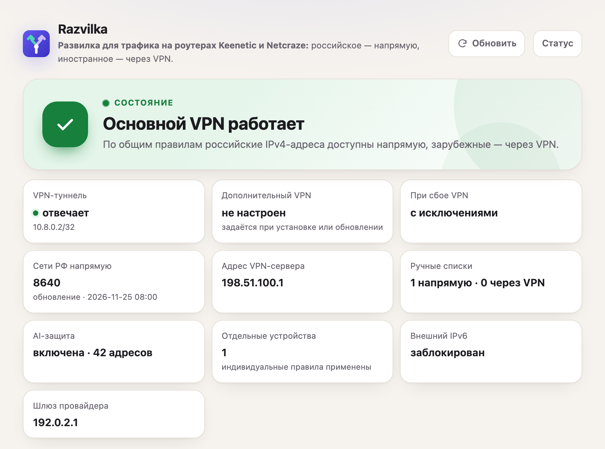
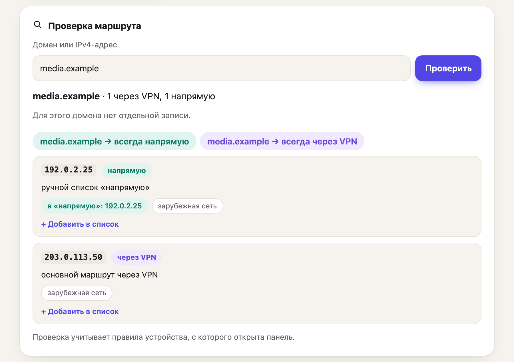
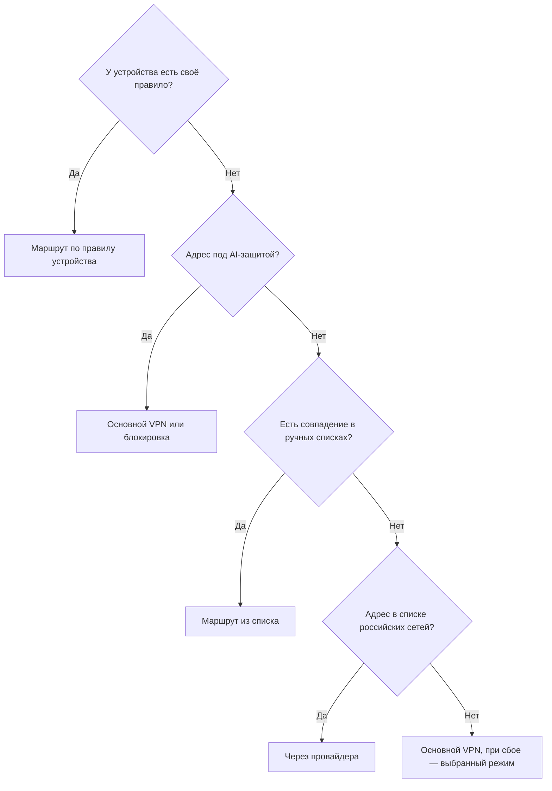

<p align="center">
  
</p>

**Развилка для трафика на роутерах Keenetic и Netcraze:** российское — напрямую, иностранное — через VPN.

Razvilka работает через Entware и использует VPN, который уже настроен на роутере. Для конкретного сайта или устройства можно выбрать другой маршрут.

Роутер выбирает маршрут по IPv4-адресу назначения с учётом правила для устройства. У российского сайта видео может загружаться с зарубежного сервера — тогда страница и видео пойдут разными путями. В панели можно проверить каждый адрес и добавить исключение.

## Что нужно заранее

- Keenetic или Netcraze с Entware и доступом к shell от имени root. Для установки с компьютера нужен SSH (обычно порт `222`).
- VPN-клиент с сетевым интерфейсом Linux. Подходят, например, WireGuard и AmneziaWG (`wg*`, `nwg*`, `opkgtun*`), OpenVPN или sing-box в режиме TUN. Для AmneziaWG в Entware можно использовать [awg-manager](https://github.com/hoaxisr/awg-manager).
- Во время установки интерфейс должен существовать. Если он пока не отвечает, установку можно завершить. Razvilka начнёт направлять в него трафик, когда связь восстановится.

## Установка

### Прямо на роутере, одной строкой

```sh
curl -fsSL https://raw.githubusercontent.com/kubokot-tech/razvilka/main/dist/razvilka-setup.sh | sh -s -- install
```

Если `curl` нет: `opkg update && opkg install curl`.
Чтобы скачать установщик через конкретный VPN-интерфейс, укажите его имя:

```sh
curl -fsSL --interface opkgtun0 https://raw.githubusercontent.com/kubokot-tech/razvilka/main/dist/razvilka-setup.sh | sh -s -- install
```

### С компьютера (Mac/Linux)

```sh
git clone https://github.com/kubokot-tech/razvilka && cd razvilka
./install.sh root@192.168.1.1                 # пароль root спросит один раз
```

### Параметры

Установщик определяет интерфейсы автоматически. Параметры ниже позволяют выбрать их вручную или выполнить установку без вопросов.

Для PPPoE подходит маршрут вида `default dev ppp0 scope link`. Если провайдер не указывает IP шлюза, Razvilka направляет трафик в `ppp0`. При нескольких WAN нужный интерфейс можно выбрать через `--isp-if`.

```sh
sh razvilka-setup.sh install --yes --contact "Администратор домашней сети"
./install.sh root@192.168.1.1 -- --yes --contact "Иван, +7 900 000-00-00"
```

| Параметр | Что |
|---|---|
| `--vpn-if IF` | основной интерфейс VPN (по умолчанию — первый живой `opkgtun*`/`nwg*`/`wg*`/`tun*`) |
| `--vpn2-if IF` | дополнительный VPN для отдельных устройств; `--no-vpn2` — выключить |
| `--vpn2-process NAME` | имя процесса клиента дополнительного VPN для определения адреса его сервера |
| `--vpn2-server IP` | адрес сервера дополнительного VPN, можно несколько раз |
| `--isp-if IF` | интерфейс провайдера (по умолчанию — из маршрута по умолчанию) |
| `--vpn-process NAME` | имя процесса VPN-клиента: по его соединениям определяется адрес сервера (обычно находится само по init-скрипту) |
| `--vpn-server IP` | адрес VPN-сервера, если не определяется сам (у awg/wg берётся из endpoint) |
| `--vpn-restart CMD` | команда для кнопки «Перезапустить VPN» (по умолчанию — init-скрипт VPN-клиента в Entware, если он один) |
| `--web-pass PASS` | пароль панели, логин `admin` (без него — спросит или сгенерирует) |
| `--failmode direct\|soft\|kill` | что делать при падении VPN (`direct` по умолчанию) |
| `--contact TEXT` | контакт администратора на странице статуса и странице сбоя |
| `--stub-port N` | порт страницы сбоя (по умолчанию 8098) |
| `--web-port N` | порт панели (98) |
| `--hostname NAME` | имя в DNS роутера (`razvilka.lan`); `--no-hostname` — не создавать |
| `--alias-ip IP` | отдельный адрес для имени на 80-м порту (по умолчанию `.254` сети, если свободен и вне DHCP) |
| `--keep-bird` | не удалять Bird4Static/web4static |
| `--yes` | не задавать вопросов |

## Панель и страница статуса

| Что открыть из домашней сети | Адрес по умолчанию | Возможности |
|---|---|---|
| Статус | `http://razvilka.lan/` или `http://<IP-роутера>:98/status` | Состояние VPN, последние события, счётчики трафика и проверка маршрута. Открывается без пароля и обновляется каждые 30 секунд. |
| Панель управления | `http://razvilka.lan/admin` или `http://<IP-роутера>:98/admin` | Настройка маршрутов и устройств, диагностика, журнал и резервные копии. Логин — `admin`. |

Адреса с именем `razvilka.lan` работают, если установщик настроил локальное имя и отдельный IP. Фактические адреса и порт он выводит после установки.

В разделе **«Проверка маршрута»** введите домен или IPv4-адрес. Для домена роутер покажет все найденные IPv4-адреса и маршрут к каждому **с устройства, на котором открыта страница**. Чтобы проверить телевизор или рабочий ноутбук с другого компьютера, передайте исходный IPv4 устройства в команду `lookup` (пример ниже). Панель также показывает совпадения с ручными списками и позволяет добавить домен, отдельный IP или всю автономную систему.

Панель доступна из локальной сети. Для изменения настроек она проверяет источник запроса и защитный токен браузера. Публичная страница показывает результаты проверки маршрута без содержимого ручных списков.

В разделе **«Журнал»** новые записи показаны сверху. Ошибки применения правил, потеря VPN и восстановление связи отмечены цветом и текстом. Ссылки «Раньше» и «Новее» листают историю по 25 записей. Кнопка «Скачать журнал» сохраняет весь текущий `razvilka.log`, включая строки за пределами открытой страницы. На публичной странице можно листать только события связи и блокировки. Полный журнал доступен после входа в панель.

Счётчики показывают объём полученных и отправленных данных с момента запуска интерфейса. При аппаратном ускорении часть трафика может не попасть в статистику.

Пример панели и проверки домена с двумя адресами на демонстрационных данных.

<p align="center">
  
  
</p>

## Как выбирается маршрут

Для внешнего IPv4-адреса роутер проверяет правила в таком порядке.

| Приоритет | Правило |
|---|---|
| 1. Устройство | Если для исходного IP задана индивидуальная политика, роутер использует выбранный для него маршрут. |
| 2. Защита Claude Code и ChatGPT | Известные адреса этих сервисов доступны через основной VPN. При исчезновении интерфейса прямой выход к ним блокируется. |
| 3. Ручные списки | Адреса из `direct.list` направляются через провайдера, из `vpn.list` — через основной VPN. При одинаковом префиксе приоритет у `direct.list`. |
| 4. Общие правила | Российские сети из загруженного списка и адрес VPN-сервера доступны напрямую. Для остальных адресов используется основной VPN. |

Для частных сетей действуют отдельные правила доступа к локальной сети. Список российских префиксов обновляется раз в сутки из ipdeny или ipverse.



Диаграмма описывает внешние адреса. Адрес сервера самого VPN получает прямой маршрут, чтобы туннель мог переподключиться. Razvilka определяет его по соединениям VPN-клиента или по endpoint WireGuard/AmneziaWG и сохраняет последнее известное значение. Адрес также можно задать при установке через `--vpn-server`.

### Если основной VPN недоступен

| Режим в панели | CLI | Что происходит с зарубежным трафиком по общим правилам |
|---|---|---|
| Через провайдера | `direct` | Роутер разрешает прямой доступ. Это режим по умолчанию. |
| С исключениями | `soft` | Прямой доступ блокируется, кроме выбранных сетей. Например, можно разрешить CDN, откуда российский сайт загружает шрифты или видео. |
| Блокировать | `kill` | Исключения мягкого режима снимаются. Соединения, для которых нужен VPN, блокируются. |

Роутер проверяет туннель раз в минуту. После двух неудачных проверок подряд применяется выбранный режим. При запуске без VPN в режимах `soft` и `kill` блокировка устанавливается сразу. После восстановления туннеля маршруты возвращаются автоматически.

При блокировке сохраняются прямые маршруты к известным российским сетям и служебным адресам, в том числе к DNS-резолверам. Правила отдельных устройств и ручные исключения продолжают иметь свой приоритет. Если российский сайт использует зарубежный CDN, часть страницы может не загрузиться.

В мягком режиме есть готовые наборы для Cloudflare, Akamai, Fastly, библиотек JavaScript, шрифтов Google и капчи. Аналитику Google можно включить отдельно. Свои домены, IP, подсети и AS добавляются в панели или в `lists/kill-allow.list`. Разрешение общей сети CDN открывает прямой доступ и другим сайтам на тех же IP.

При обычной блокировке браузер сообщает об ошибке соединения. Если в `razvilka.conf` включить `CAPTIVE_STUB=1`, роутер сможет показывать страницу сбоя с контактом администратора для HTTP-запросов. По умолчанию эта функция отключена. Для HTTPS перенаправление на страницу сбоя недоступно.

Кнопка **«Проверить блокировку на 3 минуты»** доступна при включённых основных правилах. Она позволяет проверить поведение устройств при работающем VPN. Проверку можно остановить досрочно.

### Правила для устройств

В разделе **«Отдельные устройства»** выберите устройство из списка соседей или введите его IPv4 вручную. Закрепите этот адрес в DHCP роутера, чтобы после переподключения правило продолжало действовать для нужного устройства.

| Политика | Маршрут |
|---|---|
| Всегда напрямую | Внешние IPv4-адреса доступны через провайдера. |
| Зарубежное через VPN | Российские сети из списка доступны напрямую. Для остальных адресов нужен выбранный VPN. |
| Весь трафик через VPN | Внешние адреса, включая российские, доступны через выбранный VPN. Локальная сеть остаётся доступной. |

Можно выбрать основной или дополнительный VPN. При сбое выбранного туннеля соединения, которым он нужен, блокируются. Автоматического переключения на другой VPN нет. Правила устройств действуют и после отключения основных правил. Чтобы вернуть устройство к общей маршрутизации, удалите его индивидуальное правило.

### Защита Claude Code и ChatGPT

Эта настройка действует при любом режиме сбоя основного VPN и сохраняется после отключения основных правил. Защищаются известные IPv4-адреса сервисов, включая домены OpenAI и Anthropic и подсети ChatGPT Voice. Правило конкретного устройства имеет более высокий приоритет. [Адреса Anthropic](https://docs.anthropic.com/en/api/ip-addresses) · [Сетевые настройки ChatGPT](https://help.openai.com/en/articles/9247338-network-recommendations-for-chatgpt-errors-on-web-and-apps) · [Подсети Voice](https://openai.com/chatgpt-voice.json)

Адреса обновляются каждый час. Роутер сохраняет прежний адрес при ошибке DNS и удаляет его из динамического списка, когда прошли сутки и адрес отсутствовал в трёх успешных ответах подряд. Сайты на одном IP используют общий маршрут. Для рабочего устройства, которому нужен VPN для **всех** внешних IPv4-соединений, выберите политику «Весь трафик через VPN».

### IPv6

При новой установке включена блокировка внешнего IPv6 для устройств домашней сети. Локальный обмен, multicast и ICMPv6 разрешены. Настройка независима от основных правил и VPN. При включённой блокировке сайты только с IPv6-адресом недоступны. Если её отключить, внешний IPv6 будет идти по обычным маршрутам роутера. Выбор сохраняется при обновлении.

## Ручные списки

`/opt/razvilka/lists/direct.list` — всегда напрямую, `vpn.list` — всегда через VPN. В панели нажмите «Сохранить и применить». После редактирования файла по SSH выполните `razvilka lists`. По одной записи на строку:

| Запись | Пример | Как применяется |
|---|---|---|
| домен | `kion.ru` | преобразуется в IPv4-адреса при сохранении и каждый час; поддомены — отдельными строками |
| IP | `1.2.3.4` | как есть |
| подсеть | `5.6.0.0/16` | как есть |
| автономная система | `AS13238` | раскрывается во все анонсируемые IPv4-подсети (RIPEstat), кэш на сутки |
| комментарий | `# что это` | игнорируется; можно и в конце строки: `AS57629  # Иви` |

Списки важнее базовой таблицы, но уступают индивидуальным политикам устройств и AI-защите; при одинаковом префиксе «напрямую» важнее «через VPN». У крупных AS (Google, Amazon, Cloudflare)
тысячи подсетей — добавление AS в «напрямую» разрешает прямой маршрут ко всем этим сетям. Подсети AS лежат в
`/opt/razvilka/asn/`, обновить сейчас — `razvilka lists refresh`. Узнать, по какой записи прошёл
адрес, — `razvilka why 1.2.3.4`.

В репозитории есть [готовый список для российских онлайн-кинотеатров](examples/ru-cinemas.direct.list). Его можно скопировать в поле «Всегда напрямую». Если адрес оказался неожиданным, проверьте DNS на роутере: от ответа резолвера зависит, к какому IP будет применено правило.

## Резервная копия и обновление

В панели нажмите **«Создать резервную копию»**, затем **«Скачать архив»**. На роутере файл остаётся в `/opt/razvilka/backups/` с правами `600`. В архиве есть ручные списки, правила устройств, настройки VPN и панели, пароль панели, CSRF-токен, контакт администратора и флаги защиты. Храните архив как пароль.

Для создания и восстановления копии по SSH:

```sh
razvilka backup                       # выведет полный путь к архиву
razvilka restore /путь/к/архиву.tar.gz
```

Перед применением Razvilka проверяет состав архива, типы файлов, настройки и контрольные суммы из манифеста. Старые копии принимаются, если в них есть конфигурация, режим при сбое, файл паролей, CSRF-токен и оба основных ручных списка. При ошибке программа пытается вернуть прежние файлы и маршруты. Если откат тоже не удался, команда сообщает, где остались исходные файлы.

**Обновление.** Повторите команду установки. Установщик сохраняет файлы до остановки служб и проверяет запуск новой версии. Списки, пароль, режим при сбое VPN и выбранное состояние IPv6 сохраняются. При миграции Bird4Static установщик переносит пользовательские списки. Чтобы сохранить Bird4Static, укажите `--keep-bird`.

**Удаление.** Выполните `sh razvilka-setup.sh uninstall` на роутере или `./install.sh root@192.168.1.1 uninstall` на компьютере. Настройки, списки и каталог резервных копий сохраняются. Опция `--purge` удаляет и эти данные.

## Команды на роутере

```sh
razvilka status                       # состояние и последние строки журнала
razvilka doctor                       # диагностика VPN, DNS, IPv6, правил и панели
razvilka neighbors                    # устройства, о которых знает роутер
razvilka lookup 1.2.3.4               # маршрут с самого роутера
razvilka lookup 1.2.3.4 192.168.1.50  # маршрут с устройства 192.168.1.50
razvilka why 1.2.3.4                  # совпадение со списками
razvilka lists refresh                # перечитать списки и обновить данные AS
razvilka update                       # обновить список российских сетей
razvilka mode soft                    # режим при сбое: direct, soft или kill
razvilka killtest 3                   # проверить блокировку на три минуты
razvilka killtest off                 # завершить проверку досрочно
razvilka ai-on                        # включить защиту AI-адресов (отключить: ai-off)
razvilka ipv6-block on                # блокировать внешний IPv6 (разрешить: off)
razvilka device-set 192.168.1.50 vpn-all primary "Рабочий ноутбук"
razvilka device-set 192.168.1.51 vpn secondary "Планшет"
razvilka device-set 192.168.1.60 direct "Телевизор"
razvilka device-del 192.168.1.50       # вернуть общие правила
razvilka stop                         # отключить основные правила (включить: start)
```

### DNS и проверка адресов

Если домен получил неожиданный IP, сверьте ответ DNS на устройстве и на роутере. Они могут использовать разные резолверы. При необходимости настройте DNS-over-HTTPS или DNS-over-TLS в KeeneticOS, а затем снова выполните проверку маршрута.

## Что ставится

Пакеты Entware: `ip-full iptables ipset curl bind-dig cron flock tar lighttpd` и модули lighttpd
`cgi auth authn_file rewrite setenv`. Для блокировки внешнего IPv6 нужен `ip6tables`. Пакет `conntrack` используется для сброса соединений при смене маршрута, если он доступен.

| На роутере | Что |
|---|---|
| `/opt/razvilka/razvilka.sh` (команда `razvilka`) | основной скрипт: `start stop status update lists why lookup watchdog mode killtest` |
| `/opt/razvilka/razvilka.conf` | настройки: интерфейсы, порты, VPN-сервер |
| `/opt/razvilka/lists/direct.list`, `vpn.list` | ручные списки |
| `/opt/razvilka/devices.conf` | имена, IPv4 и индивидуальные политики устройств |
| `/opt/razvilka/csrf.token` | секрет для CSRF-cookie панели (создаётся случайно) |
| `/opt/razvilka/asn/` | кэш подсетей автономных систем |
| `/opt/razvilka/www/`, `lighttpd.conf` | панель и страница статуса (отдельный экземпляр lighttpd, CGI на shell) |
| `/opt/etc/init.d/S03razvilka`, `S81razvilka-web` | автозапуск |
| `/opt/etc/cron.{1min,hourly,daily}/razvilka` | сторож / перечитать списки / обновить сети РФ |

Таблицы и правила: `ip rule 30016 → table 1030–1036` (устройства, primary/secondary), `30017 → table 1019` (AI-защита), `30020 → table 1020` (ручные списки), `30022 → table 1022` (основной слой),
страховка `30018 to <частные сети> → main` (домашняя сеть и роутер доступны при любом состоянии таблиц),
при kill switch — `30019 iif lo → main`.

## Ограничения

- В режиме `kill` российские сайты на зарубежных CDN при упавшем туннеле работают частично или не работают.
- Устройство со **своим** VPN на другой зарубежный сервер при включённом kill switch потеряет и его.
- Маршрутизация только IPv4; внешний IPv6 блокируется по умолчанию и не направляется в VPN.
- Проверено на Keenetic Ultra (KN-1811, aarch64, KeeneticOS 5.2) с VPN-клиентом поверх TCP 443 в Entware.
  Netcraze — та же KeeneticOS и Entware, должно работать так же; отчёты приветствуются.

## Альтернативы

| | Razvilka | Bird4Static + antifilter | XKeen |
|---|---|---|---|
| логика | зарубежные IPv4-адреса через VPN по умолчанию | список блокировок в VPN | правила Xray |
| механизм | ip rule + таблицы | BGP + ip rule | TPROXY + Xray |
| туннель | любой с интерфейсом | любой с интерфейсом | Xray / sing-box |
| kill switch | да: мягкий и строгий, маршрутами | нет | зависит от конфигурации |

## Разработка

```
src/lib/      модули: core, ipv6, ai, devices, lists, kill, web, neighbors, backup, main
src/razvilka.sh  генерируемый монолит (не редактировать вручную)
src/www/      CGI и статика, остальное в src/ тоже попадает на роутер
setup.sh      установщик (выполняется на роутере)
build.sh      сначала собирает монолит из lib, затем dist/razvilka-setup.sh (base64 tar.gz)
install.sh    обёртка для Mac/Linux: build + копирование + запуск по SSH
```

После правок в `src/lib/`, остальных `src/` или `setup.sh` — `./build.sh` и закоммитить обновлённые
`src/razvilka.sh` и `dist/razvilka-setup.sh`. CI проверяет, что монолит совпадает с конкатенацией модулей,
а payload установщика — с содержимым `src/`.

Запустите `./build.sh`, затем `tests/run.sh`. Тесты проверяют переходы режимов, политики устройств, IPv6, CGI и CSRF, резервное копирование, обновление и откат установки. Отдельная проверка сверяет с исходниками содержимое готового архива и оболочку установщика. В CI также запускается ShellCheck.


## Отказ от ответственности

Razvilka — инструмент управления маршрутизацией в собственной сети пользователя: он распределяет трафик
между уже настроенными на роутере подключениями по правилам, которые задаёт сам пользователь. Проект не
содержит VPN, прокси или иных средств доступа к ресурсам, не предоставляет серверов и подключений и не
предназначен для нарушения законодательства какой-либо страны.

Пользователь самостоятельно отвечает за то, какие подключения он использует и как применяет этот инструмент,
а также за соблюдение законов своей страны, правил провайдера и условий используемых сервисов. Авторы не
поощряют и не поддерживают противоправное использование.

Программа распространяется «как есть», без каких-либо гарантий (см. [лицензию](LICENSE)). Авторы не несут
ответственности за последствия её использования, включая перебои в работе сети, утечку трафика мимо туннеля
или несовместимость с прошивкой роутера.

## Лицензия

[MIT](LICENSE)
